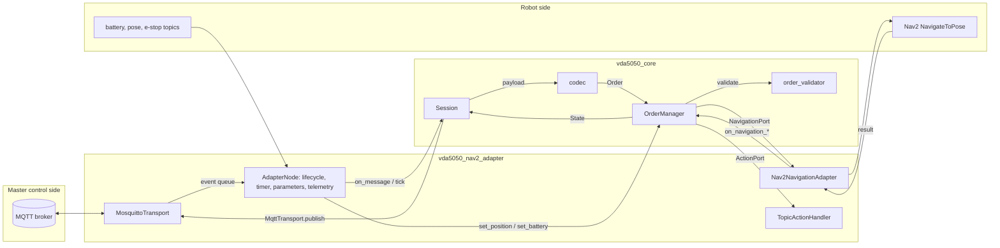
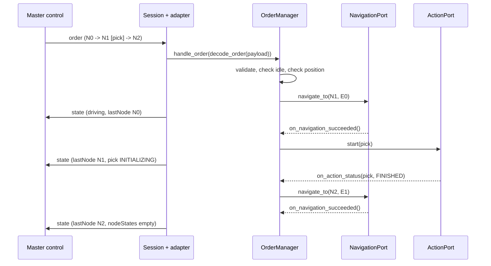
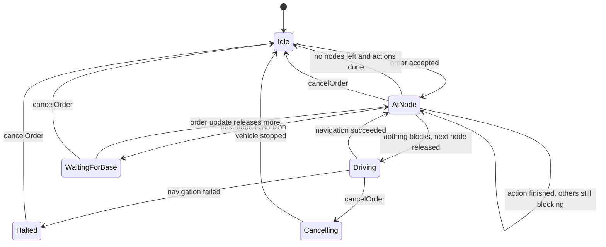

# Architecture

## Goal

Run VDA 5050 orders on a ROS 2 robot, with the protocol logic testable without
a robot, a simulator, a broker or ROS itself.

## Shape: ports and adapters

The protocol logic sits in the middle and depends on nothing but the C++
standard library. Everything that touches the outside world is behind an
interface (a *port*); the concrete implementation (an *adapter*) is plugged in
from outside.



Dependencies point inwards only: the adapter package depends on the core, never
the reverse. `vda5050_core` does not include a single ROS or MQTT header.

## Components of `vda5050_core`

| Unit | Responsibility | Knows about |
|---|---|---|
| `json` | Parse and write JSON, strictly and with bounded recursion | nothing |
| `types` | Plain structs for messages | `json` (action parameter values) |
| `codec` | JSON text <-> `types`. The only place with JSON field names | `json`, `types` |
| `header` | Identity, topic names, per-topic header ids, timestamps | `types` |
| `order_validator` | Graph rules of an order. A pure function | `types` |
| `ports` | `NavigationPort`, `ActionPort` interfaces | `types` |
| `order_manager` | The state machine: accept/reject, traverse, schedule actions, instant actions, build state | `types`, `ports`, `order_validator` |
| `session` | Owns the `OrderManager`. Routes incoming payloads, checks they are addressed to this vehicle, and decides what is published on which topic and when (connection, state, visualization, factsheet) | everything above, plus the `MqttTransport` port |

`OrderManager` deliberately does not know JSON exists. It consumes and produces
structs, so a different wire format (VDA 5050 v3, or a binary encoding) needs a
new codec and nothing else.

## How one order flows through



## The state machine

`OrderManager` keeps a small amount of state:

- `nodes_`, `edges_`: what is still ahead (this *is* `nodeStates`/`edgeStates`)
- `last_node_id_`, `last_node_sequence_id_`: where the vehicle logically is
- `actions_`: every tracked action with its status and the node/edge it belongs to
- flags: `driving_`, `paused_`, `halted_`, `cancelling_`

There is no explicit state enum. Every event handler updates this data and then
calls one function, `advance()`, which asks "given the data, what is the next
thing to do?":

```
advance_once():
  stop if: no order, paused, cancelling, already driving, halted
  1. start any node actions that are allowed to start now
     stop if a node action still blocks motion
  2. stop if there is no next node, or the next node is horizon
  3. start edge actions; stop if one blocks motion
  4. navigate_to(next node)
```

Because `advance()` is idempotent and derives its decision from data, there are
no forgotten transitions: any event that might unblock progress simply calls it.
The equivalent explicit states would be:



Pause is orthogonal to all of these: it is a flag that makes `advance()` do
nothing and tells the navigation port to hold.

## Threading and timing model

`OrderManager` is single-threaded, never blocks and never sleeps. Port calls
are requests that return immediately; results come back later as events.

In the ROS 2 adapter the node runs on a single-threaded executor, so every
callback is serialised and no mutex is needed inside the core. The one other
thread is libmosquitto's network loop: its callbacks only append to a
mutex-protected queue, which the node's timer drains on the executor thread.
No protocol code runs on the MQTT thread. A re-entrancy guard in `advance()` covers the one
remaining case: a port reporting its result synchronously from inside the call
that started the work.

Consequences:

- Every behaviour is reproducible in a unit test: no clocks, threads or sleeps.
- A slow MQTT broker or a stuck Nav2 action cannot stall the protocol logic.

## Error handling policy

| Situation | Response |
|---|---|
| Payload is not valid JSON / wrong types | `DecodeError` thrown by codec; adapter reports `validationError` |
| Order breaks graph rules | Rejected, `validationError`, running order untouched |
| Order arrives while busy / wrong position / bad update | Rejected with `orderError`, `noRouteError`, `orderUpdateError` |
| Navigation fails | `FATAL` `navigationError`; vehicle halts and waits for `cancelOrder`. No automatic retry |
| Action fails | `WARNING` `actionError`; order continues |
| Late or unknown result events | Ignored |

Exceptions are used only at the decoding boundary, for input that cannot be
interpreted. Everything after that is reported through `State.errors`, because
the party that needs to know is master control, not a C++ caller.

## The ROS 2 adapter

`vda5050_nav2_adapter` contains one class per port
plus the node that wires them:

| Class | Role |
|---|---|
| `AdapterNode` | Lifecycle node. `configure` builds everything without I/O; `activate` registers the last will, connects and starts a 20 Hz timer; `deactivate` publishes `OFFLINE` and disconnects; `cleanup` destroys. The timer drains MQTT events, refreshes the pose from tf2, and calls `Session::tick()` |
| `Nav2NavigationAdapter` | `NavigationPort` over `nav2_msgs/action/NavigateToPose`. A generation counter makes results from replaced or paused goals harmless |
| `MosquittoTransport` | `MqttTransport` over libmosquitto: asynchronous connect, automatic reconnect with backoff, resubscribe on every connect, clean session |
| `TopicActionHandler` | `ActionPort` that forwards actions as JSON on ROS topics, so other nodes implement pick/drop/charge without recompiling the bridge |

### Why publishing happens in `tick()`

Events (an order arriving, Nav2 finishing) only change data and set a "changed"
flag. `Session::tick(now)`, called at 20 Hz, is the single place that publishes.
Several changes inside one tick therefore produce one state message, the state
is always internally consistent when sent, and time is an argument, which keeps
the periodic logic testable without sleeping.
