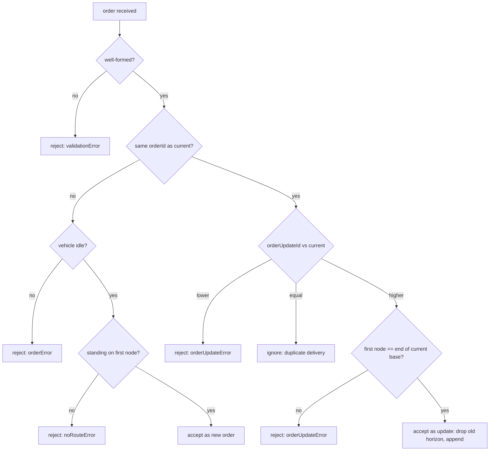

# VDA 5050 primer

A working explanation of the protocol, written for someone who has not read the
specification. Section references to code show where each rule is implemented.

The authoritative source is the specification published by the VDA and the
[VDA5050 GitHub repository](https://github.com/VDA5050/VDA5050). Where this
document and the specification differ, the specification is right.

## 1. The problem it solves

A warehouse buys robots from several vendors. Each vendor ships its own fleet
software, so the robots cannot share aisles, lifts or a task queue. VDA 5050
defines one interface between a central **master control** (the fleet manager)
and each **AGV/AMR**, so that one fleet manager can drive them all.

The division of labour is the key idea:

| Master control decides | The vehicle decides |
|---|---|
| Which vehicle does which job | How to physically drive an edge |
| The route, as a sequence of nodes and edges | Obstacle avoidance, localisation |
| Traffic: who may enter which stretch, and when | How to execute an action (pick, charge...) |

## 2. Transport: MQTT and topics

Messages are JSON documents published over MQTT. Each vehicle has its own topic
tree:

```
<interfaceName>/<majorVersion>/<manufacturer>/<serialNumber>/<topic>
uagv/v2/acme/amr-001/order
```

| Topic | Direction | Purpose |
|---|---|---|
| `order` | master -> vehicle | The route and actions to execute |
| `instantActions` | master -> vehicle | Commands that apply immediately (cancel, pause...) |
| `state` | vehicle -> master | Everything about the vehicle's current situation |
| `connection` | vehicle -> master | Online / offline, including an MQTT last-will message |
| `visualization` | vehicle -> master | High-rate position for display only |
| `factsheet` | vehicle -> master | Static capabilities of the vehicle, sent on request |

Code: `topic_name()` in `header.hpp`; `Session` in `session.hpp` decides what is sent on each.

Quality of service: every topic uses MQTT QoS 0 except `connection`, which is
QoS 1. `connection` and `factsheet` are published retained, so a master that
connects later still learns each vehicle's last connection state and its
capabilities.

Every message begins with the same header: `headerId` (a counter kept
separately for each topic), `timestamp` (ISO 8601 UTC), `version`,
`manufacturer`, `serialNumber`. Code: `HeaderFactory`.

## 3. Orders are graphs

An order is a path through a graph: an alternating list of **nodes** (places)
and **edges** (the connection between two nodes).

```
 N0 ----E0----> N1 ----E1----> N2 ----E2----> N3
seq 0   seq 1   seq 2   seq 3   seq 4   seq 5   seq 6
```

- `sequenceId` orders the elements. Nodes get even numbers, edges the odd
  numbers between. A node may appear twice in one order (a loop), which is why
  `nodeId` alone cannot identify a position in the order but
  `(nodeId, sequenceId)` can.
- Each edge names its `startNodeId` and `endNodeId`.

Code: `validate_order()` checks these rules.

### Base and horizon

Every node and edge has a `released` flag.

- **Base**: the released part. The vehicle is allowed to drive it.
- **Horizon**: the unreleased tail. A preview only; the vehicle must not enter it.

```
 N0 ====E0====> N1 ====E1====> N2 - - E2 - -> N3 - - E3 - -> N4
 |------------ base ------------|  |--------- horizon ---------|
```

This is how master control does traffic management without micromanaging: it
releases only the stretch it has reserved for this vehicle. As the route ahead
becomes free it sends an **order update** that extends the base.

The vehicle stops at the last base node and waits if no update arrives. It can
ask for more with `newBaseRequest` in its state.

Code: `OrderManager::advance_once()` step 2; `snapshot()` for `newBaseRequest`.

### New order, update, duplicate, or stale?

Two fields decide: `orderId` and `orderUpdateId`.



Three things worth understanding here:

- **Rejection never disturbs the running order.** The vehicle reports an error
  in its state and carries on.
- **Duplicates are silently ignored.** MQTT can deliver a message more than
  once, so handling an order must be idempotent.
- **Stitching.** An update's first node must be the last node of the current
  base, with the same `sequenceId`. That guarantees the two pieces join without
  a gap or an overlap.

Code: `OrderManager::handle_order()`.

## 4. Actions and blocking types

Nodes and edges can carry **actions** (`pick`, `drop`, `startCharging`, or
vendor-specific ones). Each has a unique `actionId` and a `blockingType`:

| blockingType | Other actions in parallel? | Driving allowed? |
|---|---|---|
| `NONE` | yes | yes |
| `SOFT` | yes | no |
| `HARD` | no (runs alone) | no |

Actions on a node are processed in the listed order. Each one's progress is
reported in `state.actionStates`:

```
WAITING -> INITIALIZING -> RUNNING -> FINISHED
                              |  \--> PAUSED
                              \-----> FAILED
```

`FINISHED` and `FAILED` are terminal.

Code: `OrderManager::start_ready_actions()` and `motion_blocked_by()`.

## 5. Instant actions

Sent on their own topic and executed immediately, independent of the order.
Implemented here:

| actionType | Effect |
|---|---|
| `cancelOrder` | Stop, fail the not-yet-finished order actions, clear the remaining nodes. It is `RUNNING` until the vehicle has actually stopped, then `FINISHED`. With no order active it is `FAILED` with a `noOrderToCancel` error. |
| `startPause` / `stopPause` | Hold position / continue. State shows `paused: true`. |
| `stateRequest` | Publish a state message now. |
| `factsheetRequest` | Publish the factsheet. |
| anything else | Passed to the vehicle's `ActionPort` if it supports the type, otherwise `FAILED`. |

After a cancel the state keeps the cancelled `orderId` and the `lastNodeId`
until a new order arrives, so master control always knows where the vehicle is
logically.

## 6. State

The vehicle publishes its whole state as one message: on every relevant event,
and periodically (the specification allows at most 30 s between messages).
Key fields:

| Field | Meaning |
|---|---|
| `orderId`, `orderUpdateId` | The order being executed, or the last one |
| `lastNodeId`, `lastNodeSequenceId` | The last node reached |
| `nodeStates`, `edgeStates` | What is still **ahead**. Reached nodes are removed, so an empty list means the route is done |
| `actionStates` | Status of every action of the order, plus instant actions |
| `driving`, `paused`, `newBaseRequest` | Motion flags |
| `agvPosition`, `velocity`, `batteryState` | Telemetry |
| `operatingMode` | `AUTOMATIC`, `MANUAL`, ... Orders are refused outside `AUTOMATIC` and `SEMIAUTOMATIC` |
| `errors` | Each with `errorType`, `errorLevel` (`WARNING` or `FATAL`), references and a description |
| `safetyState` | E-stop type and protective-field violation |

Code: `State` in `types.hpp`, `OrderManager::snapshot()`, `encode_state()`.

## 7. Connection and last will

On connecting, the vehicle publishes `connectionState: ONLINE` (retained). It
also registers an MQTT **last will** message with `CONNECTIONBROKEN`, which the
broker publishes on the vehicle's behalf if the connection drops without a
clean disconnect. A clean shutdown publishes `OFFLINE`. That is how master
control distinguishes "switched off" from "lost in a Wi-Fi dead zone".

Code: `Session::last_will()`, `on_connected()`, `shutdown()`; the libmosquitto
side is `MosquittoTransport` in the adapter package.

## 8. Versions

- This project targets **v2.0**. Topic names carry only the major version (`v2`).
- **v2.1** is stated by the VDA to be backwards compatible with 2.0.0. Its
  additions (for example a `maps` field in the state) are not implemented.
- **v3.0** has been published and renames concepts (for example
  `mobileRobotPosition` in place of `agvPosition`), so it is not wire-compatible
  with v2. Supporting it would mean a second codec; the state machine is
  version-neutral by design. See the roadmap.

### Where the official sources disagree

Validating against the official JSON schemas (see `testing.md`) turned up
places where the schemas and the specification text differ. The library is
tolerant on input and follows the text on output.

| Topic | Specification text | Official schema | This library |
|---|---|---|---|
| Instant action type | `actionType` | 2.0.0: `actionName`; 2.1.0: `actionType` | Accepts both |
| Action status `PAUSED` | Defined | Missing from the enum in 2.0.0 and 2.1.0 | Emits `PAUSED` (ADR-019) |
| `allowedDeviationXY` | That spelling | 2.0.0: `allowedDeviationXy`; 2.1.0: `allowedDeviationXY` | Accepts both, writes the spelling from the text |

Code: `decode_action()` and `decode_node_position()` in `codec.cpp`.
